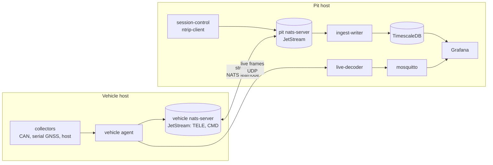
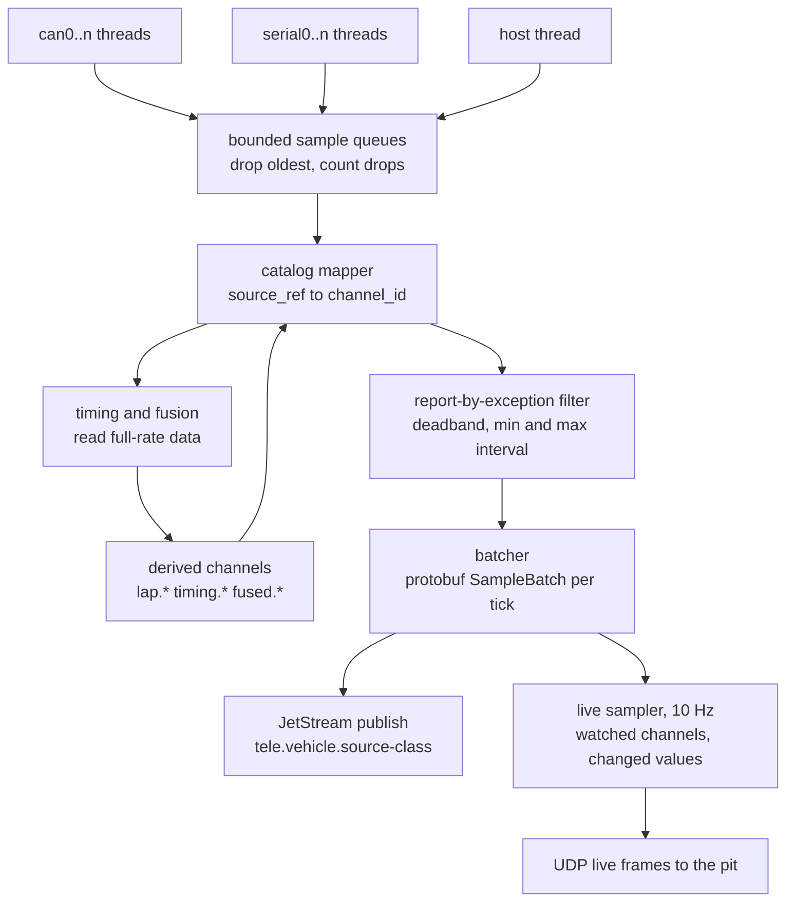
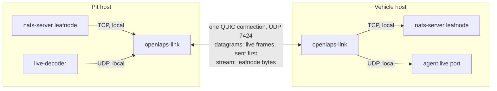
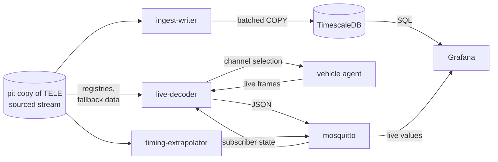
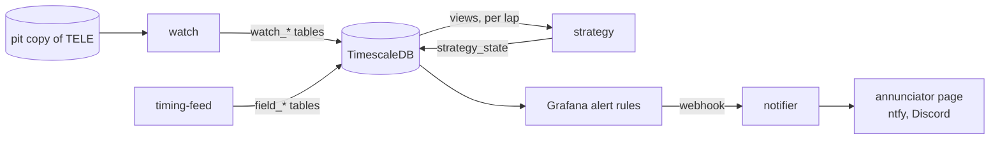
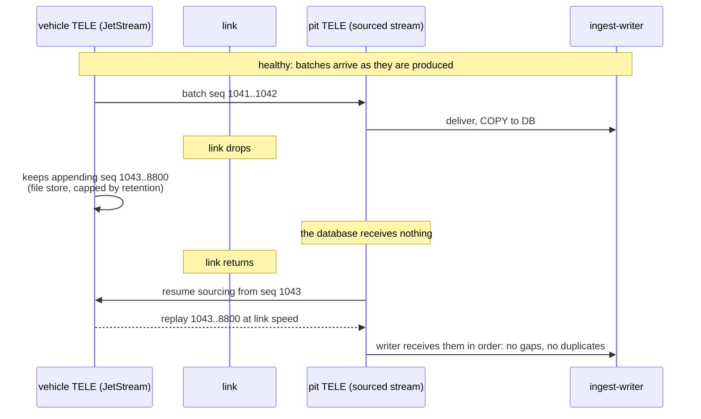

# openlaps architecture

openlaps is a racing telemetry system that runs on two hosts. The **vehicle**
host collects sensor data, computes lap timing, and stores everything in a
durable local stream. The **pit** host receives that stream over a wireless
link, writes it to a time-series database, and serves live and historical
dashboards.

Everything specific to one car (buses, DBC files, sensors, channel names,
tracks) is in a configuration *profile* (see `CATALOG.md`). The code is the
same for every car.

## System overview

Data crosses from the vehicle to the pit in two ways:

- **The stream** carries every sample. The vehicle stores it in a JetStream
  stream named `TELE`. The pit holds a *sourced* copy: it pulls from the
  vehicle's stream by sequence number over a NATS leafnode connection.
  After any interruption the pit resumes from the last sequence it
  received, so the database ends up complete without a separate
  synchronisation step. The stream is always in order, which means it is
  late whenever the link is slower than the data.
- **Live frames** carry only the newest value of the channels a dashboard
  is showing. They are UDP datagrams, sent when a value changes, and are
  never queued or retried. They keep the gauges current while the stream
  is behind.

An optional **link tunnel** carries both inside one QUIC connection and
sends live frames first. See [The vehicle-to-pit link](#the-vehicle-to-pit-link).

## Layers

| Layer | Does | Knows about |
| --- | --- | --- |
| **Collectors** | Read a transport and decode it: socketCAN frames to DBC signals, serial bytes to NMEA fields, host statistics | The transport only. A collector emits `Sample{source_ref, t, value}`, where `source_ref` is `bus:device.MESSAGE.SIGNAL` |
| **Channel catalog** | Maps each source ref to a named channel (eg. `car.rpm`, `position.lat`, `car.accel_x`) with units, type and link policy | The profile YAML. Integer channel IDs are assigned here, through the `ChannelRegistry` |
| **Apps and consumers** | Lap timing, sensor fusion, dashboards, exports | Channel names only |

Because consumers see only channel names, the hardware behind a channel can
change without changing any consumer. For example, the timing engine subscribes to
`position.*` so it doesn't matter whether fixes come from a serial GNSS receiver or from a CAN
frame. Moving a signal to different hardware requires a catalog edit (`CATALOG.md`
has a worked example).

Derived data such as lap and sector events,
delta to best lap, predicted lap, distance, and the fused navigation
solution are published as `lap.*`, `timing.*` and `fused.*` channels and
reach the pit like any other sensor channel.

## Vehicle agent data flow

The full specification is in `AGENT_DESIGN.md`. The main points:

- **Timestamps.** Each `SampleBatch` carries the UTC time of the batch, and each sample carries a microsecond offset from it, so the capture time of every sample is preserved through batching. The batch also carries a reading of the vehicle's monotonic clock (a counter that is never adjusted), so elapsed time on the vehicle can be measured even if the UTC clock is corrected (eg if GPS gets a fix on startup).
- **Report-by-exception (RBE) applies to the link, not to the apps.** The
  timing engine and the fusion filter read the data before the RBE filter,
  so they always see every sample. Each RBE channel has a `max_interval`
  after which its value is sent even if unchanged, so a consumer never has
  to carry a value forward for longer than that.
- **Overload drops the oldest data and counts it.** Every queue is bounded.
  The drop counters are channels themselves (`sys.agent.*`), so overload
  appears on a dashboard.
- **Local durability.** The agent publishes to a NATS server on the same
  host. Data can be lost only if the host crashes between capture and the
  local acknowledgement.
- **Live sampling happens at the vehicle.** The agent keeps the newest
  value of each channel the pit has asked for and sends the changed ones
  ten times a second. The pit decides which channels; the vehicle holds no
  list of its own.

## Wire format

Defined in `WIRE_FORMAT.md` and `proto/telemetry.proto`.

Channels are registered once in a `ChannelRegistry` message (id to name,
units, type, source ref). Data travels in `SampleBatch` messages, one per
tick per source class, each holding `{channel_id, t_offset, value}`
entries. Channel names are never repeated in the data. `LINK_BUDGET.md`
has the measured bandwidth.

## The vehicle-to-pit link

The link is any IP path between the two hosts. The pit starts every
connection, so the vehicle needs no knowledge of the pit's address and the
pit can be behind NAT.

### Paths

openlaps does not depend on a particular radio. It has been run over:

- an 802.11ah (HaLow) radio network, as a plain local network;
- Starlink, through a Tailscale overlay network;
- both at once, with Tailscale choosing HaLow when it works and Starlink
  when it does not.

A cellular modem would be used the same way as Starlink: as another
internet path under the overlay. This has not been tested.

Each part of the link handles more than one path:

| Part | With several paths |
| --- | --- |
| Overlay network (Tailscale) | Gives the vehicle one address and moves between the underlying paths itself. Nothing in openlaps sees the change |
| Link tunnel | Dials every configured vehicle address at once and uses the first that answers. Redials when the path in use has been silent for 8 s |
| Live frames | The pit asks on a preferred address, and on the backup addresses only while the preferred one has delivered nothing for 3 s |
| Leafnode, without the tunnel | Tries its configured URLs in order each time it reconnects |

An overlay network is optional. On a single local network each part is
given one address.

`tools/car_link.sh` on the pit host shows which path is in use and can
force Starlink only. The car camera is deliberately limited to Starlink so
that video never uses HaLow capacity (`deploy/video-tunnel/README.md`).

### Link tunnel

Sent as two separate flows, the stream and the live frames share the
radio's queue. When the stream is catching up it fills that queue, and
live frames wait behind it.

`openlaps-link` (`rust/link`) runs at both ends and puts both flows in one
QUIC connection:

- Live frames travel as QUIC datagrams. They are sent before stream data
  and dropped if they cannot be sent.
- The leafnode connection travels as a QUIC stream. Its TCP connection
  ends at the local `openlaps-link` on each host, so no TCP crosses the
  radio.
- The tunnel limits the stream's rate by measured delay. It holds the
  queue it adds to the path at about 150 ms, so a live frame waits no
  longer than that whatever the link's capacity.
- Both ends authenticate with the leafnode's certificates.
- When the tunnel is enabled it is the only route for the stream. While
  the tunnel is down the leafnode retries once a second, and the pit
  catches up from the vehicle's stream when it returns.

The tunnel is enabled with the `link` profile of the pit stack and the
`openlaps-link` service on the vehicle. Without it, the leafnode connects
to the vehicle directly and live frames travel as plain UDP. Details and
bench measurements: `WIRE_FORMAT.md`, sections "Live link" and "Link
tunnel".

## Pit data flow

### Core services

- **ingest-writer** is a durable JetStream consumer. It decodes each batch,
  resolves channel IDs against the registry, and writes rows to the
  `samples` hypertable with batched `COPY`. Lap and sector events also
  become rows in the `laps` table.
- **live-decoder** runs at the pit and publishes channel values as JSON to
  a local MQTT broker (mosquitto), which Grafana's live panels subscribe
  to. MQTT is used only here and never crosses the link. Where the values
  come from is set by `OPENLAPS_LIVE_SOURCE`:

    | Value | Source | Behaviour on a slow or interrupted link |
    | --- | --- | --- |
    | `pit` (default) | The pit's sourced copy of the stream | Gauges replay the backlog in order and are late until it has crossed |
    | `vehicle` | The vehicle's stream, read through the leafnode | Gauges are current once the link returns. Every batch crosses the link twice |
    | `direct` | Live frames from the vehicle | Gauges stay current. A late frame is dropped, not queued |

    In `direct` mode the selection of channels is made at the pit and the
    sampling is done at the vehicle. The live-decoder asks the broker which
    channels have a subscriber and requests only those, so the vehicle
    sends a channel only while a dashboard is showing it, and sends almost
    nothing when no dashboard is open. If no frames arrive for 30 s the
    live-decoder shows the pit's sourced copy until they return.

- **timing-extrapolator** publishes running lap and sector clocks for the
  pit wall between the vehicle's timing events.
- **session-control** publishes driver, stint and session state on
  `cmd.<vehicle>.*`, which reaches the vehicle over the leafnode. The agent
  attaches the active session to derived channels so that every lap is
  attributed to a session and driver.
- **ntrip-client** runs at the pit because the pit has the internet
  connection. RTK correction bytes go to the vehicle on core NATS
  (`rtcm.<vehicle>`) without persistence, because an old correction has no
  value. The NTRIP credentials are never on the vehicle.
- **pit-monitor** records the state of the pit itself: chrony, host
  resources, the ntrip-client's `/health`, and the NATS monitoring port.
  It writes to the `pit_metrics` table (`PIT_SCHEMA.md`). It reads nothing
  from the stream and publishes nothing. It runs in the host network
  namespace so that it can reach chronyd and see the real machine. The
  NATS endpoint `/leafz` on the pit reports the leafnode's remote end, so
  the state of both ends is recorded without contacting the vehicle.

### Derived services

These services compute data instead of carrying it (ADR 0011). Each writes
its own tables and publishes live values only under its own namespace
(`watch.*`, `strategy.*`, `field.*`).

- **watch** reads the sourced stream and scores anomaly monitors: fixed
  envelopes, per-lap drift, physical ratios per gear and per wheel, the
  rate of a counter, and a whole-car regression model that ranks the
  channels contributing to a finding. Scores and findings go to the
  `watch_*` tables and to the reliability dashboard. Findings raise alerts
  through the same Grafana rules as thresholds. Reference: `WATCH.md`.
- **strategy** runs once per lap from the database views. It computes fuel
  remaining and burn rate with bounds, the pit window, the stop plan
  against the operator's race plan, driver-time compliance, the target lap
  and the refuel clock. Each evaluation is a `strategy_state` row. Its
  warnings are `strategy.*` findings, alerted by the same rules. It does
  not yet forecast the race against the rest of the field.
- **timing-feed** reads the other cars from a timing provider into the
  `field_*` tables. Sources are the Natsoft TCP feed, a replayed capture
  file, snapshots posted by a browser relay, or messages from a Timing71
  service; all fill the same schema. Every live document is saved so a
  session can be replayed. It also compares our own car's lap count with
  the timekeepers' and raises a `field.lap_count` finding when they
  differ.
- **notifier** is the only contact point Grafana alerts are sent to. It
  records every alert in the `alert_events` table, serves the annunciator
  page (sound, acknowledge buttons, a heartbeat), repeats unacknowledged
  critical alerts, and forwards by severity to phones through the stack's
  own `ntfy` server and to Discord. `ntfy` works on the pit network with
  no internet connection; Discord messages are queued until there is one.

## Link dropout and recovery

No operator action is needed. Recovery is the same whether the gap was a
few seconds of link dropout on one part of the track, or there was no link
until the car returned to the pits.

**A slow link behaves like a short dropout.** If the vehicle produces more
than the link can carry, the stream falls behind and nothing is discarded.
The database is complete once the stream catches up. What the live panels
show meanwhile depends on the live source (see the table above): with
`direct` they stay current, with `pit` they fall behind with the stream.
The amount of data per channel is set by `rate_cap` and `rbe` in the
catalog.

**How lag is observed.**

- `sys.agent.publish_lag_ms` is measured on the vehicle: the age of the
  agent's oldest unacknowledged publish to its local server. It reaches
  the pit as an ordinary channel, so during a dropout its value at the pit
  stops updating.
- The ingest-writer's `/health` endpoint reports how far the pit's write
  path is behind. This figure is relative. The vehicle's and the pit's
  monotonic clocks have no common epoch, so the endpoint reports how much
  transit time has grown from the best recently observed: about zero on a
  healthy link, rising when the pit falls behind. It also reports
  `wall_lag_ms` from wall-clock time, which is only as accurate as the
  vehicle's clock (`WIRE_FORMAT.md`, Timestamp scheme).

## Deployment

The pit runs as one Compose stack (`deploy/pit-compose.yaml`). The vehicle
runs either as a Compose stack (`deploy/vehicle-compose.yaml`) or as
systemd services with NATS in a container, depending on the board
(`operations/vehicle.md`).

All credentials (NATS credentials, TLS material, database and dashboard
passwords, the NTRIP account, the live-frame key) are supplied through
environment variables or mounted files documented in `example.env`. None
are in the repository.

The two NATS servers run **separate JetStream domains** (`veh` and `pit`).
This is what allows one server to address the other's streams over the
leafnode: the pit sources the vehicle's `TELE` into its own `TELE_VEHICLE`,
and session-control publishes into the vehicle's domain through its local
server. `deploy/README.md` is the operational reference: start-up order and
how to verify each hop.

Optional parts, each enabled by a Compose profile or a systemd unit:

| Part | Purpose | Reference |
| --- | --- | --- |
| Link tunnel (`link`) | Live frames ahead of the stream on a shared link | `WIRE_FORMAT.md`, Link tunnel |
| Video (`video`) | Car camera through go2rtc, relayed to the pit network | `deploy/video-tunnel/README.md` |
| Remote ECU tuning (`ecu`) | The car's ECU USB port presented to a tuning PC at the pit | `operations/remote-ecu.md` |

## Document map

- `WIRE_FORMAT.md`: subjects, streams, protobuf schema, registry lifecycle, timestamps, live link, link tunnel
- `AGENT_DESIGN.md`: vehicle agent threads, queues, RBE behaviour, failure modes
- `CATALOG.md`: profile schema (`vehicle.yaml`, `catalog.yaml`), naming convention, worked examples
- `FUSION.md`: the IMU and GNSS navigation filter
- `PIT_SCHEMA.md`: the pit database: tables, registry resolution, compression, views
- `LINK_BUDGET.md`: measured bandwidth against radio capacity
- `../deploy/README.md`: the two stacks, the leafnode topology, start-up and verification
- `operations/index.md`: deployment and verification guides
- `status.md`: what is implemented and what is still to be validated
- `WATCH.md`: watch configuration and monitor behaviour
- `RAW_CAPTURE.md`: local capture of raw inputs
- `adr/`: decision records with the alternatives considered
