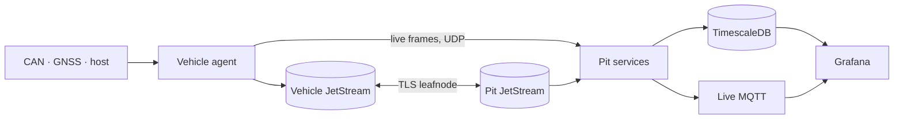

# openlaps

Open-source telemetry for club-level motorsport. openlaps collects CAN, GNSS
and host data in the vehicle, sends it to the pit over a NATS JetStream link
that recovers from dropouts, and serves live and historical pit-wall views
from TimescaleDB and Grafana.

[Get started](getting-started/index.md){ .md-button .md-button--primary }
[View the architecture](ARCHITECTURE.md){ .md-button }

## What it does

- Collects multiple SocketCAN buses, serial GNSS and host health data.
- Maps hardware-specific signals onto a stable channel catalog.
- Calculates laps, sectors and timing deltas in the vehicle.
- Stores telemetry on the vehicle and resumes transfer after radio dropouts.
- Keeps live gauges current on a slow link by sending the watched channels
  separately from the full stream.
- Works over one network or several (eg HaLow radio and Starlink).
- Stores named samples, laps, sessions, strategy and field timing at the pit.
- Serves provisioned Grafana dashboards, alerts and phone notifications.

## Topology

The vehicle holds the durable telemetry stream. The pit copies it by sequence
number, so a temporary link failure delays data instead of discarding it.
Live frames carry only the channels a dashboard is showing, so gauges stay
current while the stream is behind.

## Choose a path

| Goal | Start here |
| --- | --- |
| Understand the system | [Architecture](ARCHITECTURE.md) |
| Run a local development environment | [Development](getting-started/development.md) |
| Install a vehicle | [Vehicle installation](operations/vehicle.md) |
| Install the pit stack | [Pit installation](operations/pit.md) |
| Configure a car | [Profiles and channel catalog](CATALOG.md) |
| Configure lap, sector and pit lines | [Track setup](TRACK_SETUP.md) |
| Check implementation maturity | [Project status](status.md) |
| Diagnose a deployment | [Verify the stack](operations/verification.md) |

## Documentation policy

Current behavior is described in the concepts, configuration, operations and
reference pages. ADRs explain why decisions were made. Dated bench reports
record evidence. The historical plans are not specifications for the current
system.
